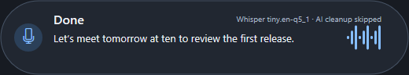
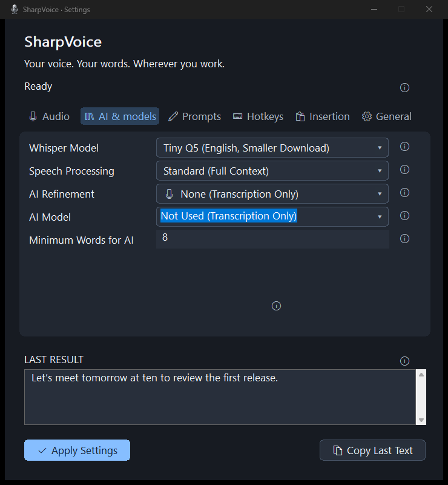
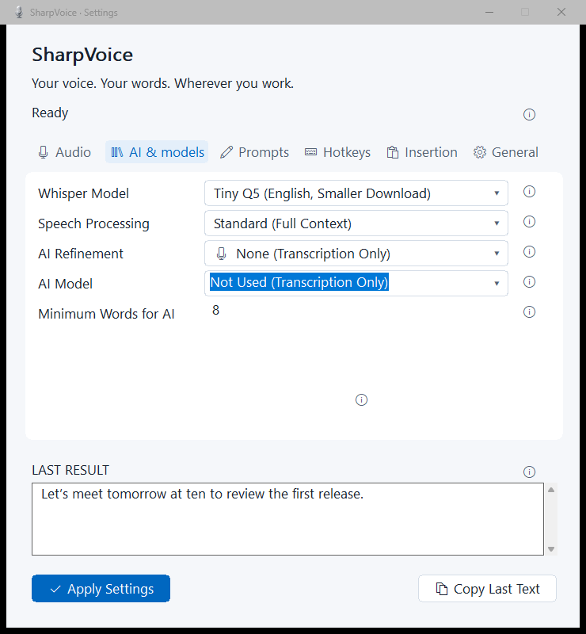
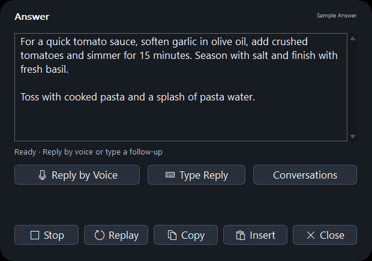

  

<h1 align="center">SharpVoice</h1>

<strong>Your voice. Your words. Wherever you work.</strong>

Windows dictation with local transcription, optional AI cleanup, and voice-driven coding.

  <a href="https://github.com/rleonard55/SharpVoice/releases/latest">Download for Windows</a> ·
  <a href="docs/user-guide.md">User Guide</a> ·
  <a href="extensions/sharpvoice-vscode/README.md">VS Code Plugin</a> ·
  <a href="LICENSE">MIT License</a>

  

## Quick start

1. **[Download the installer](https://github.com/rleonard55/SharpVoice/releases/latest/download/SharpVoice-win-x64-Setup.exe)** and launch SharpVoice. It starts in the system tray; double-click the microphone icon to open Settings. A [portable ZIP](https://github.com/rleonard55/SharpVoice/releases/latest/download/SharpVoice-win-x64-Portable.zip) is also available.
2. **Start with the included speech model.** The default installer and portable ZIP include Tiny Q5 English—no separate model download needed. AI cleanup starts off, so you can dictate without an AI account.
3. **Focus a text field**, hold **Ctrl + Alt**, wait for the tone, and speak. Release to transcribe and insert your words.

**First launch:** New users automatically get a skippable setup wizard on first launch for microphone testing, shortcuts, optional AI, and practice dictation. The wizard is not available from Settings. Existing profiles keep tray-only startup.

Requires **Windows 10/11 x64** and an **AVX2/FMA-capable CPU**. No separate .NET installation is needed. Allow desktop microphone access in Windows Settings if prompted.

> **Early release:** The installer is unsigned, so Windows may show a publisher or SmartScreen warning. Try dictation in Notepad first. Exit an already-running development copy before launching an installed copy.

## Speak, edit, ask

| What you want to do | How it works |
| --- | --- |
| **Dictate into an app** | Hold **Ctrl + Alt**. Local Whisper turns speech into text; optional AI cleans up longer dictation. |
| **Rewrite selected text** | Select text, hold **Ctrl + Alt**, and describe the change. An AI provider is required. |
| **Ask AI** | Hold **Ctrl + Alt + Shift** and ask a question or request content. Choose a provider in **AI & Models** first. |
| **Hear an answer and follow up** | Enable **General → Smart Ask AI**. Questions open an answer popup with readout, voice replies, and a text fallback. |
| **Write or refactor code** | Install the VS Code plugin from **General → Plugins**. Speak or type a request, review the diff, then Apply. |
| **Make it your own** | Set custom shortcuts, prompts, dictionary entries, voice snippets, and per-app profiles. |

Shortcuts are configurable, with hold or toggle recording. Ordinary dictation below **8 words** skips AI cleanup by default; Ask AI and selected-text edits always use AI. Optional wake phrases let you start without pressing a key.

The [default cleanup prompt](src/SharpVoice.Core/DefaultPrompts.cs) is built into the app. **Prompts → General Instructions** is pre-filled with that text on a fresh install. Existing saved instructions are preserved; leaving the field blank still uses the packaged defaults.

## A small app, with room to grow

<table>
  <tr>
    <td></td>
    <td></td>
  </tr>
</table>

Settings follow Windows light/dark mode. Help stays behind the **ⓘ** controls, and the live pill shows provisional words while you speak. Drag the pill to move it; its position is remembered.

- **Choose your AI:** ChatGPT account sign-in, Claude through Claude Code, Gemini through Antigravity or an AI Studio API key, or local Qwen models. [Provider setup →](docs/user-guide.md#ai-refinement)
- **Keep a conversation going:** recent Ask AI threads stay in app memory until exit. Reply by voice or type a follow-up.
- **Bring context into VS Code:** the companion panel uses the current language and bounded document context. Code changes require a diff preview and explicit approval. [Plugin guide →](extensions/sharpvoice-vscode/README.md)
- **Connect existing tools:** opt-in Connected Ask AI uses selected Codex connections, shows activity, and requires visual approval for supported changes. [Connected tools →](docs/connected-ask.md)

  

Screenshots use sample text rendered by the real app UI; no private conversations or account details are shown.

## Privacy and control

**Speech transcription runs locally.** AI cleanup is optional. When you choose a cloud provider, text and relevant context are sent to that provider; Edge readout sends answer text to Microsoft. Provider and external CLI retention policies still apply.

The microphone opens **on hotkey by default**. Keep Ready and wake listening are opt-in modes that keep local capture active. Conversations and dictation history stay in memory by default; encrypted local dictation history is optional. [Privacy and provider details →](docs/user-guide.md)

Installed releases check GitHub for updates. In **General → Updates**, turn automatic updates on/off independently of **Notify Only**, **Download Automatically**, or **Install When Idle**. The default installs after a quiet interval without active voice/AI work or open settings/review windows. Restart clears in-memory conversations. [Update details →](docs/releasing.md#automatic-updates)

## Guides and development

| Start here | Go deeper |
| --- | --- |
| [User guide](docs/user-guide.md) | Models, prompts, shortcuts, wake phrases, and troubleshooting |
| [VS Code plugin](extensions/sharpvoice-vscode/README.md) | Installation, code context, conversations, and diff review |
| [Build from source](docs/development.md) | Requirements, commands, and offline checks |
| [Build a release](docs/releasing.md) | Installer, portable packages, and GitHub updates |
| [Wake diagnostics](docs/wake-diagnostics.md) | Guided tests and log export |
| [Known gaps and verification](docs/spec-completion.md) | [Test evidence](docs/verification.md) and [Windows smoke tests](docs/windows-smoke-test.md) |

Found a problem? [Open an issue](https://github.com/rleonard55/SharpVoice/issues) with your Windows version, speech model, provider, and steps to reproduce. Remove private text, credentials, and account details from logs and screenshots before sharing.

## License

SharpVoice-owned code is licensed under the **[MIT License](LICENSE)**. Third-party libraries, model weights, runtimes, and provider artwork retain their own licenses and terms; see [Third-party notices](docs/third-party-notices.md) and the [bundled speech runtime notices](vendor/edge-speech/README.md).
